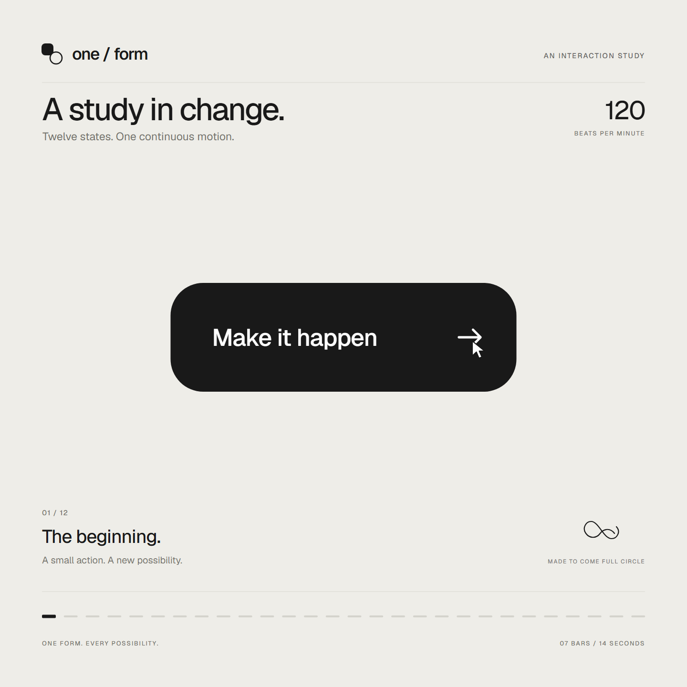
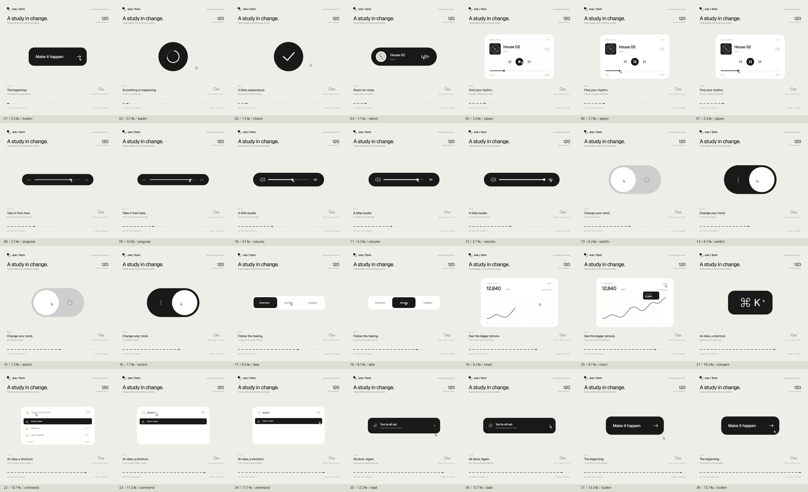
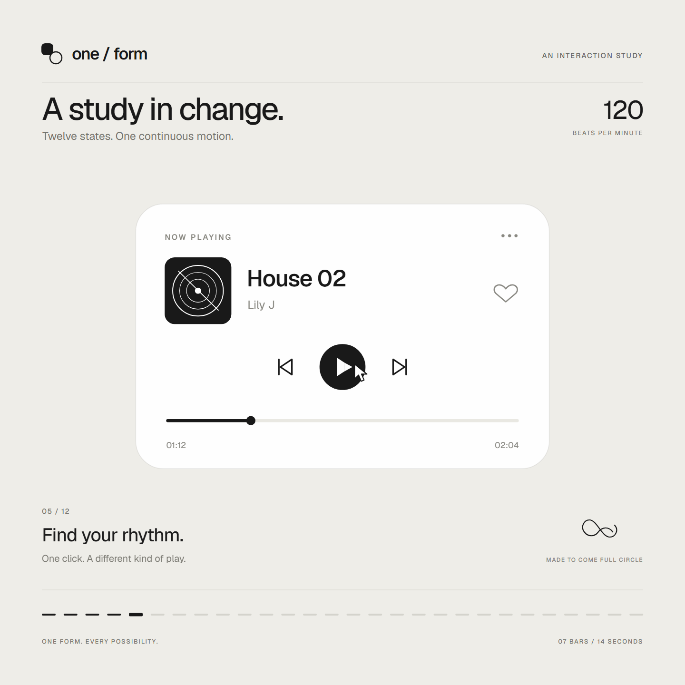
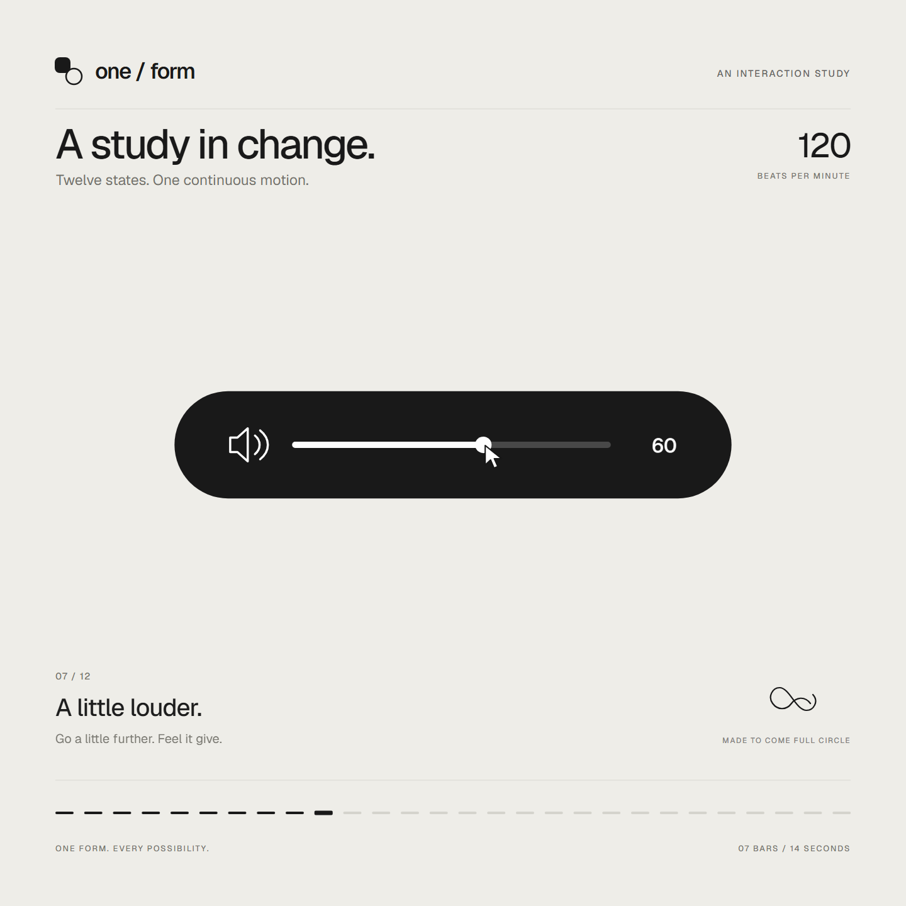
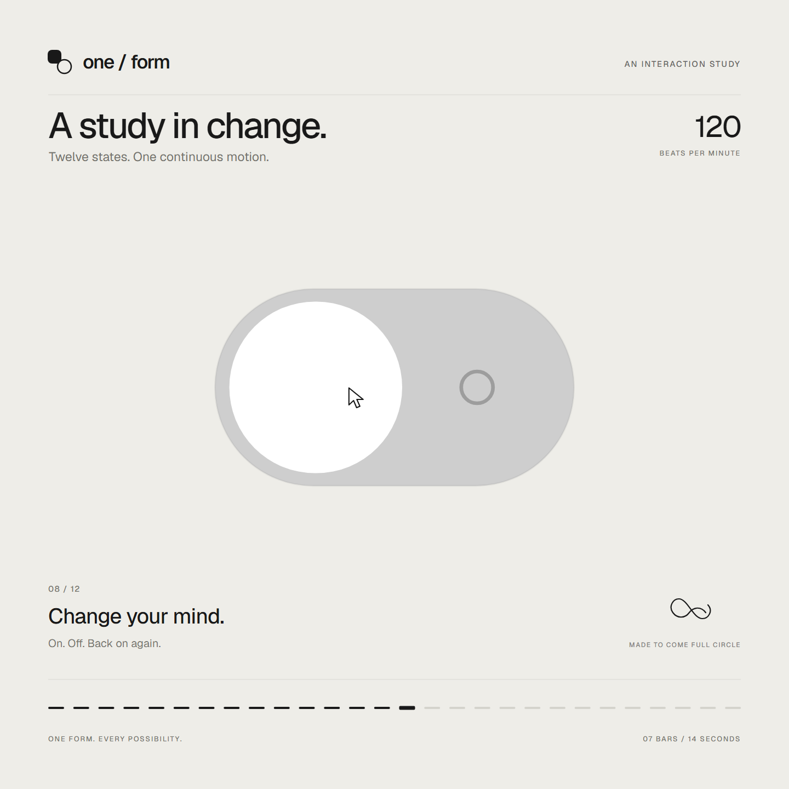
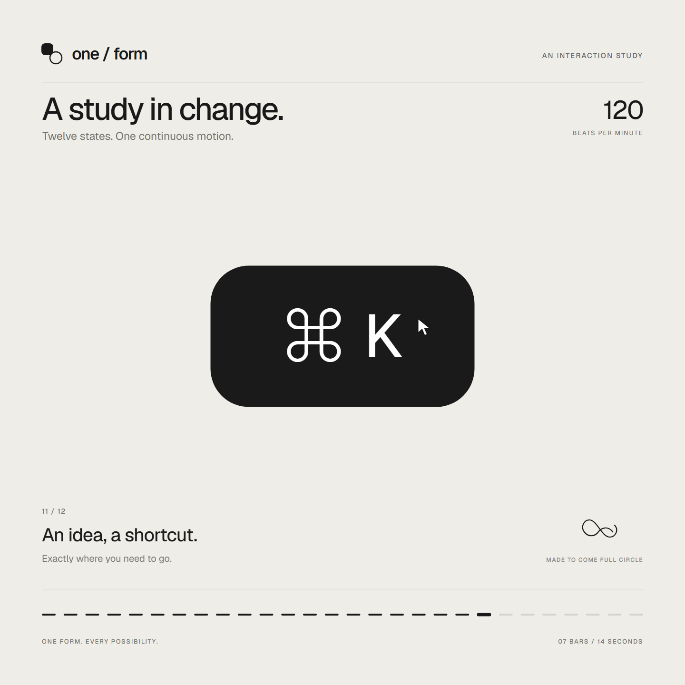

# one-form — 单一形状的 UI 形态动画

一个 Dribbble 级别的 UI 动效短片：**同一个形状永不被切断**，它在按钮、加载器、音乐播放器、滑块、开关、标签页、图表、命令面板与 Toast 通知之间连续形变——只改变大小、圆角与颜色，内容以短暂模糊切换。全程弹簧动画、镜头缩放、首尾帧完全一致，可无缝循环。

## 提示词 / Prompt

以下为创作时使用的原始提示词（Vibe Coding Prompt）：

### Inputs

> 请向我询问：我希望形状变成的 8 到 12 种 UI 状态（例如按钮、加载器、播放器、滑块、开关、标签页、图表、命令面板、Toast 通知），是纯黑白配色还是包含一种强调色，以及一首约 120 BPM 的免版税歌曲（例如来自 Mixkit，可免费商用）。

### Direction

> Dribbble 级别的 UI 动效。单一形状，永不切断：每个状态都是同一元素在改变其大小、圆角半径和颜色，同时内容通过短暂的模糊效果进行切换。光标通过真实的点击和拖拽驱动每一次变化。浅暖灰色画布，黑白组件，一款简洁的 UI 字体 (Geist)。处处使用弹簧动画，最多只有微小的过冲。镜头缩放使每个状态填满画面。最后一帧即第一帧，从而实现无缝循环。
>
> 禁止事项：弹跳缓动、粒子爆发、光晕、UI 框架上的渐变、不匹配的图标描边、死时间、任何看起来像模板的效果。

### Structure

> 120 BPM，7 小节，每个节拍都有动作发生。
>
> 按钮 → 加载器 → 对勾 → 灵动岛 → 带有播放/暂停形态变换的音乐播放器 → 拖动进度条 → 它变成一个音量滑块，当被拖拽超过最大值时拉伸 → 开关在节拍上翻转 → 旋钮变成液态标签指示器 → 标签页展开为自动绘制的图表，悬停时显示工具提示 → 它折叠成 ⌘K → 输入以过滤 → 回车 → Toast 通知 → 回到按钮。

### Build

> 1. 单个 HTML 文件，正方形 1440x1440。所有样式均在 seek(t) 内部根据时间计算得出：不使用 CSS 过渡，不使用计时器，帧之间不携带状态。
> 2. 弹簧动画采用闭式阶跃响应。如果一个值的目标多次改变，它是每次改变对应的一个弹簧之和，从而保持其为时间的纯函数。
> 3. 标签指示器的两个边缘分别跟随不同的弹簧，因此前导边缘会超前于后随边缘拉伸。开关旋钮也使用同样的技巧。
> 4. 拖拽是直接操作：当光标按住时，值根据其位置计算得出。释放时，它会从当前位置回弹。
> 5. 使用 numpy 分析歌曲以获取节拍网格，并从强拍开始。根据测量到的峰值放置每个 UI 音效。
> 6. 使用 Playwright 渲染：每帧 4 个子帧，并使用 ffmpeg tmix 在 60fps 下进行混合以实现运动模糊。
> 7. 在完整渲染之前，先按节拍渲染单帧。修正任何偏离网格、拥挤或难以阅读的内容。

### Gotchas

> 切勿在任何被镜头缩放或导致文本渲染模糊的元素上使用 will-change。在形态变换容器内切换的文本需要独立的进入和退出时序，否则会发生重叠。确保最后一帧与第一帧完全一致，包括光标位置和速度，否则循环会出现卡顿。

### Start

> 向我询问输入参数，然后在编写任何代码之前，先在节拍网格上展示状态列表给我看。

## 效果图 / Preview






 

 


## 技术栈 / Tech Stack

| 类别 | 技术 |
| --- | --- |
| 运行时 | 单个 HTML 文件，1440×1440 正方形；原生 JavaScript，零框架 |
| 动画模型 | 所有样式在 `seek(t)` 内按时间计算——无 CSS transition、无计时器、帧间不携带状态，画面是时间的纯函数 |
| 弹簧物理 | 闭式阶跃响应（closed-form step response）；目标多次改变时为多个弹簧的叠加 |
| 形变技巧 | 标签指示器 / 开关旋钮的两个边缘分别跟随不同弹簧，形成前导边拉伸效果 |
| 直接操作 | 按住拖拽时按光标位置实时取值，释放后从当前位置回弹 |
| 音频 | Web Audio API，内嵌 Mixkit 免版税曲目（约 120 BPM）与按峰值摆放的 UI 音效；Geist 字体 |

## 离线制作管线 / Production Pipeline

1. **Python + NumPy** 分析歌曲，提取节拍网格并从强拍开始
2. 按节拍先渲染单帧校对（对齐、拥挤度、可读性）
3. **Playwright** 自动化逐帧渲染，每帧渲染 4 个子帧
4. **FFmpeg `tmix`** 将子帧混合为 60fps 运动模糊，NVENC 硬件编码成片
5. 末帧与首帧（含光标位置与速度）严格一致，保证无缝循环

## 本地运行 / Run

```bash
# 直接用浏览器打开 index.html，或：
python -m http.server 8000
npx serve .
```

## 许可 / License

代码以 MIT License 发布。音乐来自 Mixkit，遵循 Mixkit 免费许可；Geist 字体遵循其自带许可（见 OFL 文本）。
