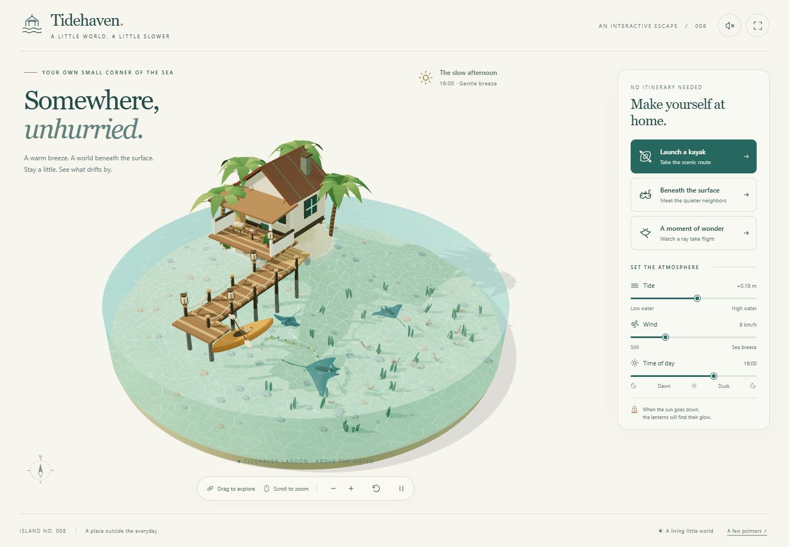
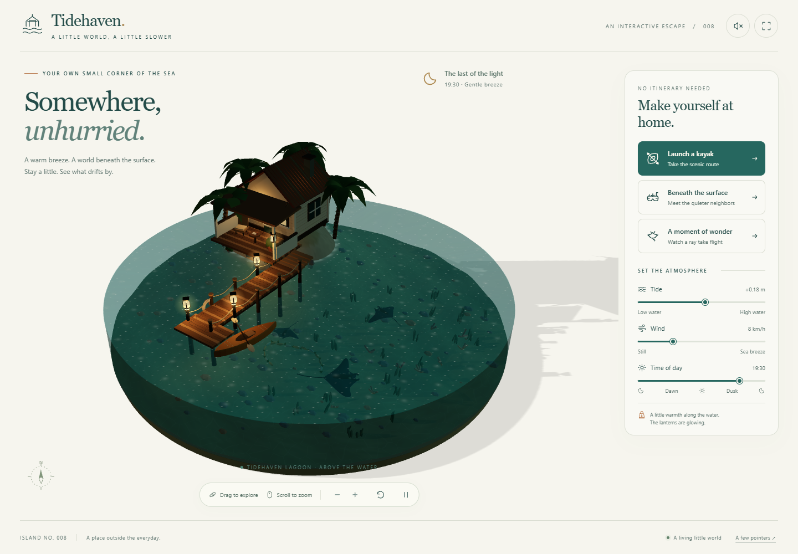
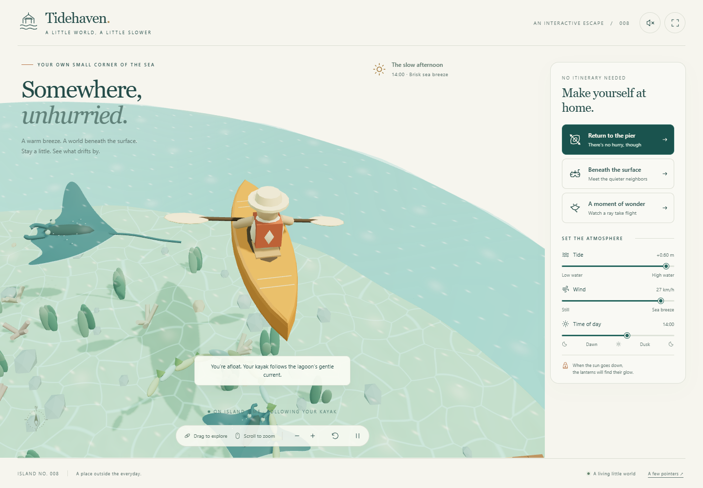
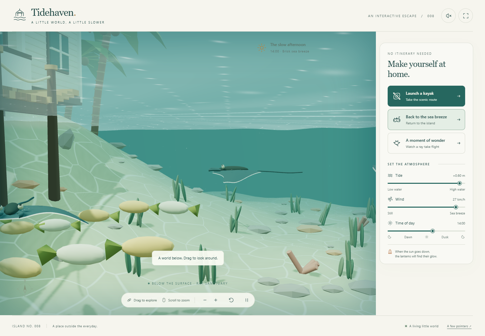
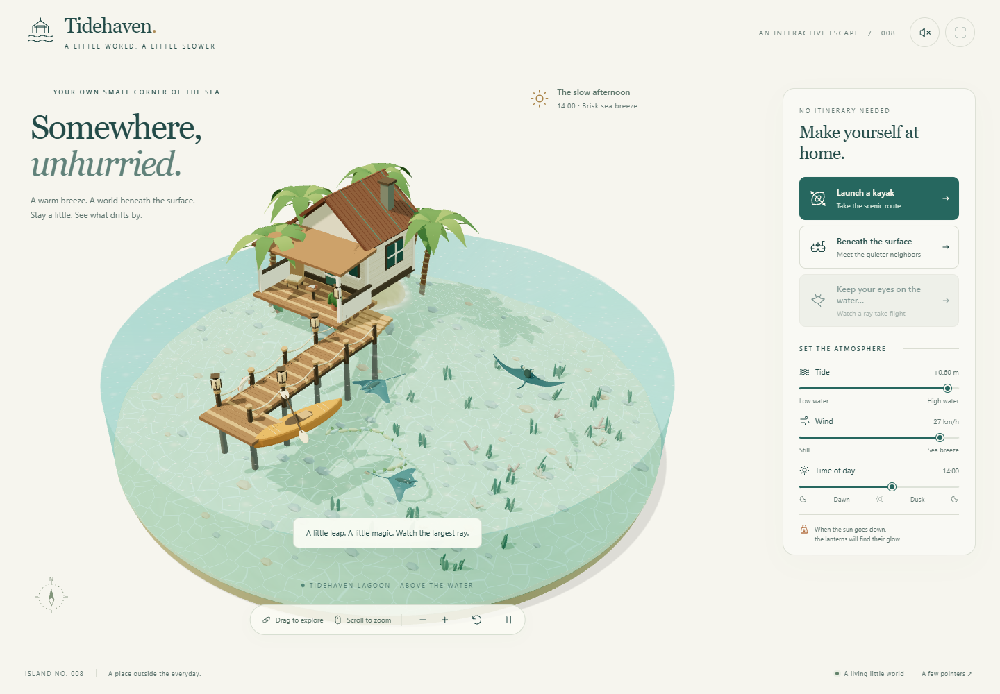
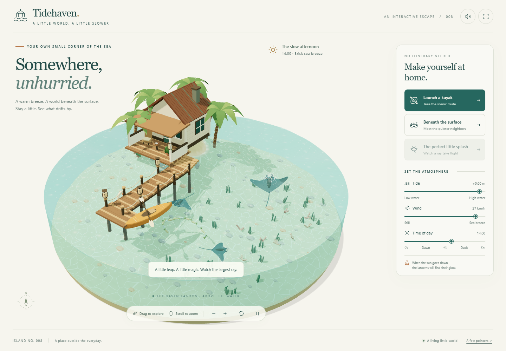
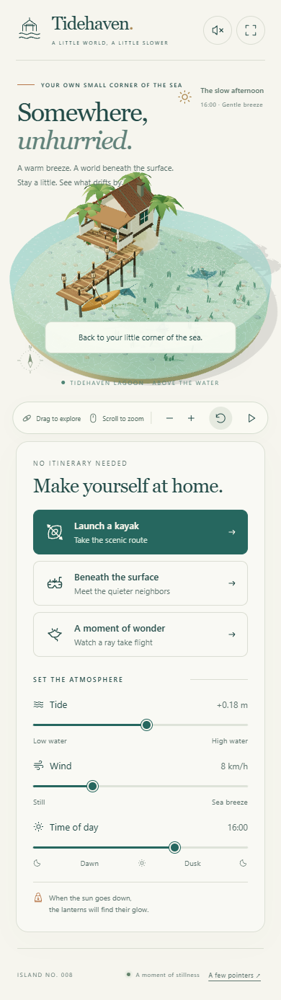

# Tidehaven — A little world, a little slower

Tidehaven 是一个运行在浏览器中的交互式 3D 海岸小岛立体模型（diorama）：铜顶小屋、木栈桥与清澈潟湖中游动的鳐鱼。你可以划皮划艇、潜入水下、看鳐鱼跃出水面，并用滑块调节潮汐、风力与时间；日落时分灯笼会逐一点亮，光斑在海底轻轻舞动。

## 提示词 / Prompt

> Create an interactive 3D diorama named Tidehaven using Three.js and WebGL. Include a copper-roofed cabin, a wooden pier, and a crystal-clear lagoon with swimming rays. Implement features to launch a kayak, take the camera underwater, and watch a ray leap out with a splash. Add controls to adjust the tide, wind, and time of day. Ensure lanterns light up at sunset while patterns of light dance across the seabed. The entire experience must run in the browser as a single HTML file.

## 效果图 / Preview















## 功能特性 / Features

- **自由探索**：鼠标 / 触摸拖拽环绕小岛，滚轮或捏合缩放，带罗盘指示朝向
- **三种沉浸体验**：
  - Launch a kayak — 乘皮划艇沿潟湖绕行
  - Beneath the surface — 镜头潜入水下，带水下暗角
  - A moment of wonder — 鳐鱼跃出水面并溅起水花
- **氛围控制**：潮汐高度、风速、一天中的时间（0:00–24:00）三个滑块实时生效
- **昼夜循环**：日落后小屋与栈桥的灯笼自动点亮，阳光在海底投下随波晃动的光斑
- **环境音景**：程序化合成的海风与海浪声，可随时开关
- 支持全屏、键盘操作与移动端响应式布局

## 技术栈 / Tech Stack

| 类别 | 技术 |
| --- | --- |
| 3D 渲染 | Three.js（内联于页面）、WebGL（`WebGLRenderer`，抗锯齿、透明通道、高性能模式） |
| 语言 | 原生 HTML / CSS / JavaScript，零框架、零构建步骤 |
| 纹理 | Canvas 2D 程序化生成（径向光晕等），无外部贴图依赖 |
| 音频 | Web Audio API：以滤波白噪声（`BiquadFilter`）实时合成海风 / 海浪，不含音频文件 |
| 布局 | 响应式 CSS（桌面 / 平板 / 移动多断点）、CSS 变量主题 |
| 无障碍 | ARIA 标注、键盘导航（方向键环绕、`+/-` 缩放、`M` 静音）、跳转链接、`prefers-reduced-motion` |

## 本地运行 / Run

直接用浏览器打开 `index.html` 即可；如浏览器对本地文件有限制，也可起一个静态服务器：

```bash
# 任选其一
python -m http.server 8000
npx serve .
```

然后访问 http://localhost:8000 。需要支持 WebGL 并开启硬件加速的现代浏览器。

## 许可 / License

代码以 MIT License 发布；Three.js 遵循其原有许可。
