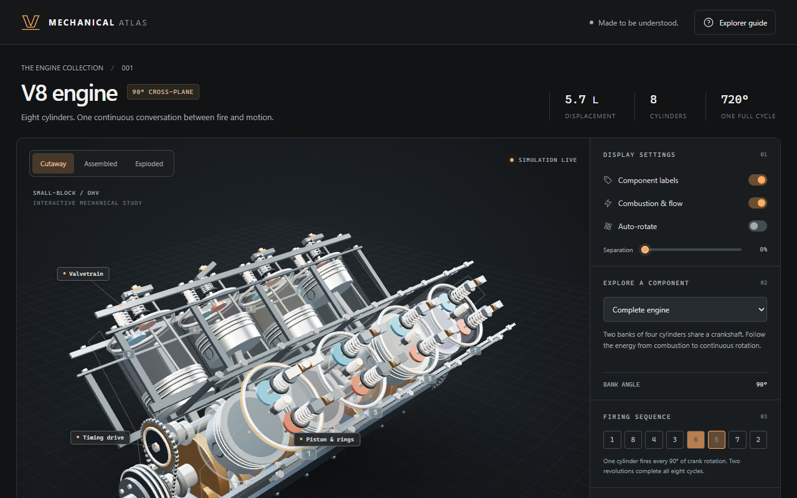
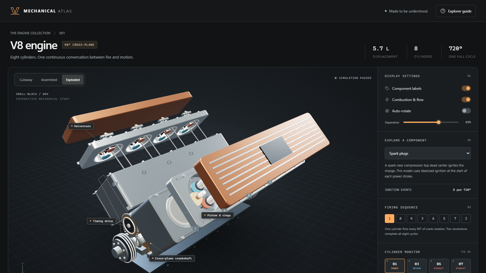
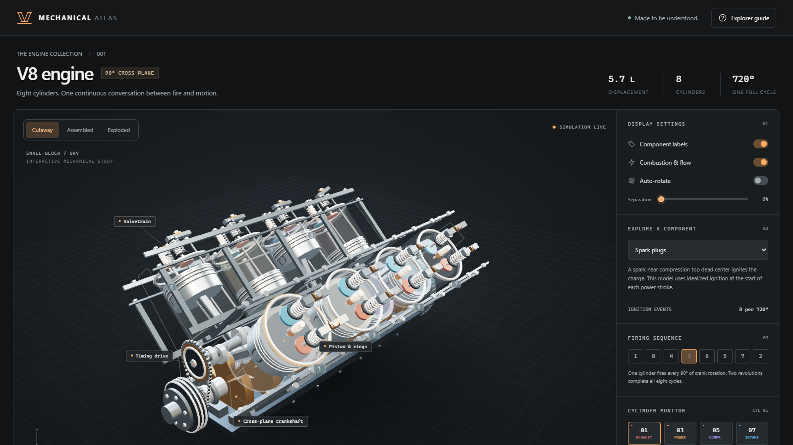
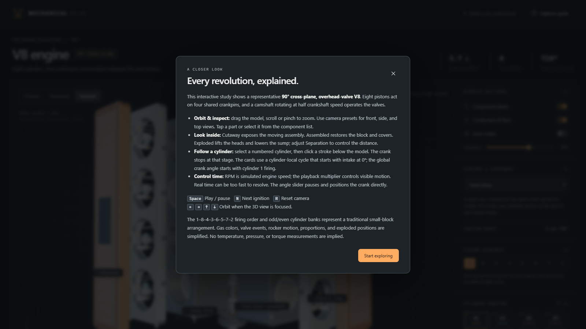

# V8 Engine · Mechanical Atlas

一个高度细节化、可交互的 V8 发动机可视化：在深色工程工作台中拆解一台 90° 十字曲轴（cross-plane）顶置气门 V8，观察活塞、曲轴、连杆、气门与摇臂的实时联动，按点火顺序追踪每个气缸的四冲程循环。

## 提示词 / Prompt

> create a highly detailed, interactive visualization of a V8 engine

## 效果图 / Preview









## 功能特性 / Features

- **三种视图模式**：
  - Assembled — 完整装配外观
  - Cutaway — 剖视，露出内部运动组件
  - Exploded — 爆炸视图，分离距离可通过滑块调节
- **零件级交互**：点击任意零件或从部件列表中选择，带引出线（leader line）标注；相机提供前 / 侧 / 顶视预设
- **真实的运动学联动**：8 个活塞驱动 4 个共享曲柄销，凸轮轴以曲轴一半的转速驱动气门与摇臂
- **点火顺序**：1–8–4–3–6–5–7–2，曲轴每转 90° 一个气缸点火，两转完成全部八个循环
- **四冲程讲解**：进气、压缩、做功、排气四张循环卡片，可选定指定气缸并跳转到对应冲程
- **播放控制**：播放 / 暂停、逐次点火步进、RPM 滑块、播放倍速、曲轴角度直接定位

## 技术栈 / Tech Stack

| 类别 | 技术 |
| --- | --- |
| 3D 渲染 | Three.js（内联于页面）、WebGL（`WebGLRenderer`，抗锯齿、透明通道） |
| 建模 | 全部为程序化几何体（`BoxGeometry` / `CylinderGeometry` 等），无外部模型文件 |
| 标签 | Canvas 2D 绘制气缸编号 Sprite、径向阴影与零件标签纹理 |
| 界面 | 原生 HTML / CSS 深色工程风 UI，等宽字体数据面板 |
| 交互 | 射线拾取（raycasting）、真实鼠标 / 触摸事件、键盘快捷键 |
| 语言 | 原生 JavaScript，零框架、零构建，单 HTML 文件 |
| 快捷键 | `Space` 播放暂停、`N` 下一点火、`R` 重置视角、方向键环绕 |

## 本地运行 / Run

```bash
# 直接用浏览器打开 index.html，或：
python -m http.server 8000
npx serve .
```

## 说明 / Notes

本作品为**代表性的简化教学模型**：气体颜色、气门事件、摇臂动作、部件比例与爆炸位置均做了艺术化简化，不包含任何真实的温度、压力或扭矩测量，不代表特定型号发动机。

## 许可 / License

代码以 MIT License 发布；Three.js 遵循其原有许可。
